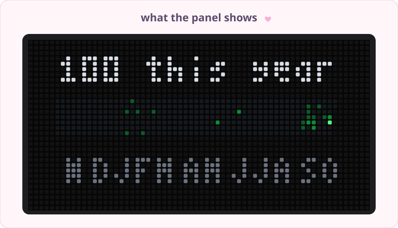
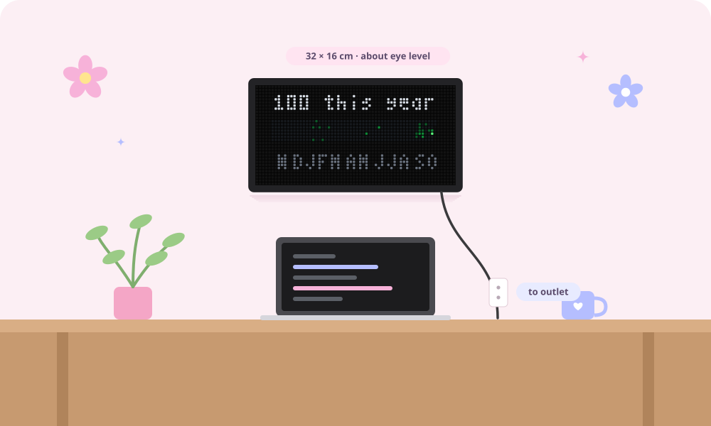
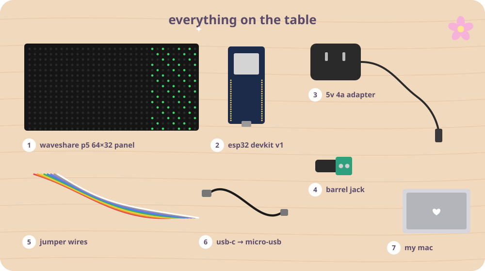
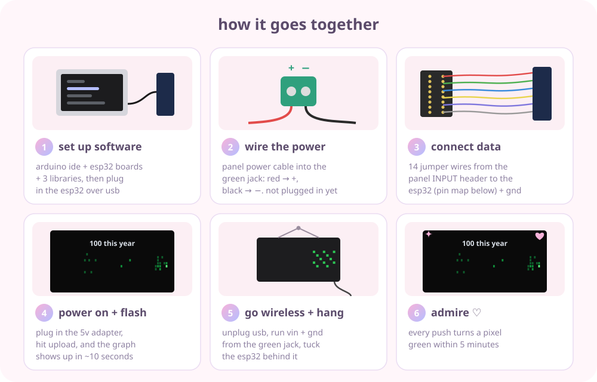
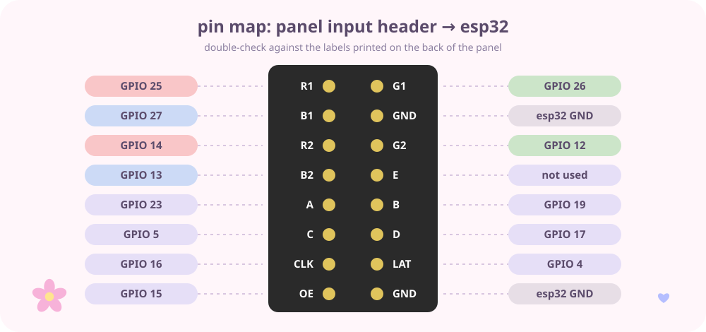
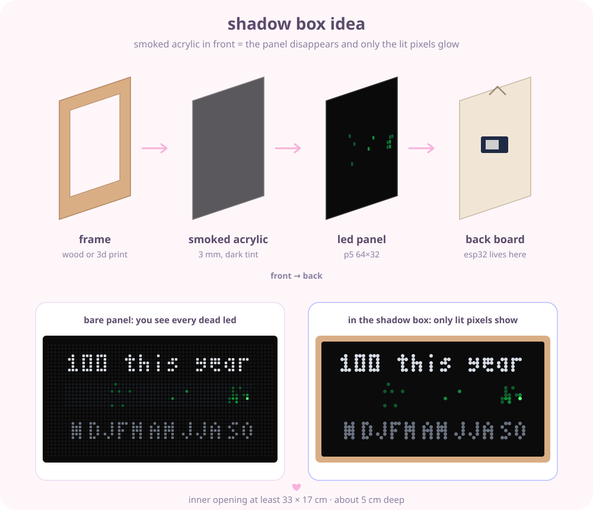

  

  
  
  
  

## ✿ what is this

i wanted my github contribution graph on my wall, glowing, updating on its own. so i'm building one 🎀

it's an esp32 + a 64×32 rgb led panel. every 5 minutes it asks github for my contribution calendar and redraws it, so every time i push code a little pixel turns green on my wall. it shows the total at the top and month letters along the bottom, just like my profile.

  

## ♡ the mock sketches

before buying anything i asked claude to sketch what it'd actually look like on my wall, to scale, so i could pick the right panel size. these are the sketches (real pics coming once it's built!)

  

## 🛍️ hardware

everything i ordered, prices in CAD from amazon.ca:

| | part | notes | price |
|---|---|---|---|
| 1 | **waveshare rgb led matrix panel, p5, 64×32** | 32 × 16 cm, 1/16 scan, hub75. comes with the ribbon cable, power cable, barrel jack + screws | $45.99 |
| 2 | **diymall doit devkit v1, esp32-wroom-32** | cp2102, micro-usb. has to be a *regular* esp32, the c3 doesn't work with the led library | $23.99 |
| 3 | **facmogu 5v 4a power adapter** | 5.5 × 2.1 mm barrel plug. 5v only, a 12v one would fry the panel | $15.99 |
| 4 | **elegoo 120pcs dupont jumper wires** | f-f for the data pins, m-f for powering the esp32 later | $9.99 |
| 5 | **cable matters usb-c to micro usb, 3.3 ft** | must be a *data* cable, not charge-only | $9.99 |
| | | | **~$106** |

  

## 🛠️ how it goes together

  

the 14 data wires go from the panel's **input** header (the one with the arrow pointing in) to the esp32. don't skip gnd or the panel flickers random garbage.

  

## 💻 software setup

1. install **arduino ide 2**
2. settings → additional boards manager urls → add
   `https://espressif.github.io/arduino-esp32/package_esp32_index.json`
3. boards manager → install **esp32 by espressif systems**
4. library manager → install:
   - **ESP32 HUB75 LED MATRIX PANEL DMA Display** (by mrcodetastic)
   - **Adafruit GFX Library**
   - **ArduinoJson** (by benoit blanchon)
5. make a github token: settings → developer settings → personal access tokens → **fine-grained** → public repositories, no extra permissions
6. in `firmware/github_graph_led/`, copy `secrets.example.h` → `secrets.h` and fill in your wifi + username + token
7. board: **ESP32 Dev Module** → upload ✨

> `secrets.h` is gitignored so my wifi password and token never get pushed. if you fork this, keep it that way!

### if something's off

- **esp32 won't upload or boot** → unplug the wire on gpio 12, flash, plug it back in
- **mac doesn't see the board** → install the silicon labs cp210x driver (and check it's a data cable)
- **colors look wrong or the image is shifted** → set `cfg.clkphase = true` and reflash
- **tiny red dot in the top right corner** → the last refresh failed (wifi or token). the old graph stays up until the next try
- **won't join wifi** → the esp32 only does 2.4 GHz. also watch out for curly apostrophes `’` in wifi names

## 🌷 to be added

stuff i'm doing after it works ✿

- [ ] **shadow box**: a frame with smoked acrylic in front so the panel disappears when it's off and only the lit pixels glow. thinking laser-cut or 3d-printed at the makerspace

  

- [ ] **one plug on the wall**: two wires from the green barrel jack (+ and −) to the esp32's vin and gnd, so the whole thing runs off the 5v adapter with no usb cable
- [ ] **hide the wall wiring**: a stick-on silicone cord cover from the panel down to the outlet. measuring once it's actually hung
- [ ] **mount the esp32 on the back** so nothing dangles
- [ ] **maybe later**: streak counter, a little animation when a new commit lands, a pink theme mode 🎀

## 📸 the real thing

coming soon! final pics go in [`photos/`](photos/) ♡

<!--

  

-->

---

made with ♡ by <a href="https://github.com/sillycat79">sillycat79</a> · <a href="https://sillycat79.com">sillycat79.com</a>

